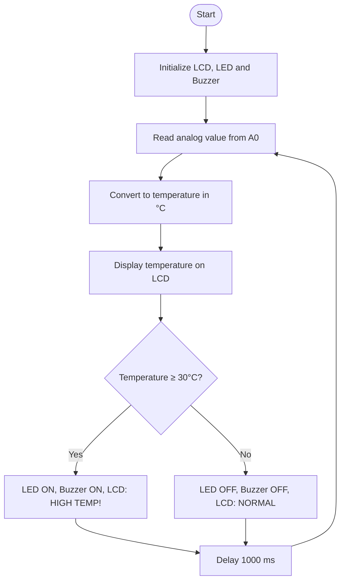
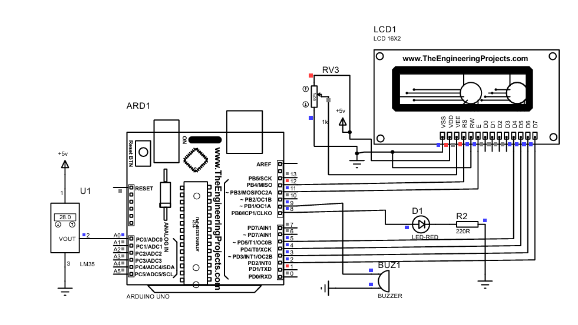
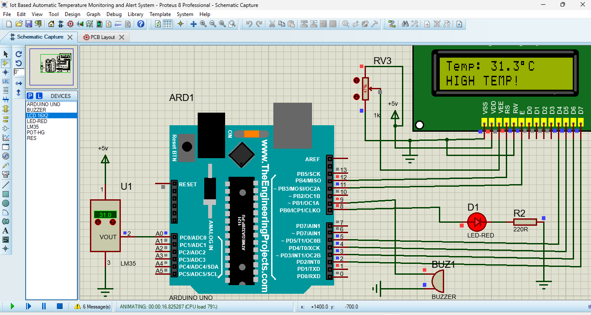

# 🌡️ Arduino-Based Temperature Monitoring and Alert System


---

## 📌 Project Overview

This project is a sensor-based temperature monitoring and alert system built with an **Arduino UNO** and an **LM35 temperature sensor**.

The system measures the surrounding temperature and shows it on a **16×2 LCD**. When the temperature reaches or exceeds the predefined threshold of **30°C**, an **LED** and a **buzzer** are activated and the LCD shows a warning message.

The circuit is designed and tested through simulation in **Proteus 8 Professional**, so no physical hardware is needed to run it.

---

## 🎯 Objectives

- Monitor temperature using an LM35 analog sensor.
- Display real-time temperature on a 16×2 LCD.
- Activate an LED and buzzer when the temperature crosses the threshold.
- Simulate and verify the circuit in Proteus.
- Understand analog sensor interfacing with Arduino UNO.

---

## 🔧 Components Required

| S. No. | Component | Quantity |
|:---:|---|:---:|
| 1 | Arduino UNO | 1 |
| 2 | LM35 Temperature Sensor | 1 |
| 3 | 16×2 LCD Display (HD44780) | 1 |
| 4 | Red LED | 1 |
| 5 | 220Ω Resistor | 1 |
| 6 | Buzzer | 1 |
| 7 | 10kΩ Potentiometer | 1 |
| 8 | Connecting Wires | As required |
| 9 | 5V Power Supply | 1 |

---

## 🔌 Pin Connections

### Sensor, LED and Buzzer

| Component | Arduino Pin |
|---|---|
| LM35 VCC | 5V |
| LM35 Output | A0 |
| LM35 GND | GND |
| LED (Anode, via 220Ω resistor) | D8 |
| LED (Cathode) | GND |
| Buzzer Positive | D9 |
| Buzzer Negative | GND |

### 16×2 LCD (4-bit mode)

| LCD Pin | Connected To |
|---|---|
| RS | D12 |
| Enable (E) | D11 |
| D4 | D5 |
| D5 | D4 |
| D6 | D3 |
| D7 | D2 |
| RW | GND |

### LCD Power Connections

| LCD Pin | Connected To |
|---|---|
| VSS | GND |
| VDD | 5V |
| V0 / VEE | Potentiometer middle pin (contrast control) |
| Backlight Anode (A) | 5V through a suitable resistor |
| Backlight Cathode (K) | GND |

> **Important:** Use **5V**, not 12V, for the LCD logic supply.
> The two outer pins of the potentiometer go to 5V and GND.

---

## ⚙️ Working Principle

1. The **LM35** measures the surrounding temperature.
2. It produces an analog voltage proportional to temperature: **10 mV per °C**.
3. The Arduino reads this voltage on pin **A0** using its 10-bit ADC (0–1023).
4. The reading is converted to degrees Celsius.
5. The temperature is shown on the LCD.
6. If the temperature is **below 30°C**, the LCD shows `NORMAL`, and the LED and buzzer stay OFF.
7. If the temperature is **30°C or above**, the LED and buzzer turn ON and the LCD shows `HIGH TEMP!`.

### 📐 Temperature Calculation

```
Voltage (V)      = ADC Value × (5.0 / 1023.0)
Temperature (°C) = Voltage × 100
```

Example: an ADC value of 61 gives 61 × 5.0 / 1023 ≈ 0.298 V, which is about **29.8°C**.
An LM35 output of **0.30 V** corresponds to **30°C**, the alert threshold.

### 🔄 Flowchart



---

## 💻 Arduino Code

File: `temperature_monitor.ino`

```cpp
#include <LiquidCrystal.h>

// LCD pins: RS, EN, D4, D5, D6, D7
LiquidCrystal lcd(12, 11, 5, 4, 3, 2);

// Component pins
const int LM35_PIN = A0;
const int LED_PIN = 8;
const int BUZZER_PIN = 9;

// Temperature limit
const float TEMP_LIMIT = 30.0;

void setup()
{
    // Set output pins
    pinMode(LED_PIN, OUTPUT);
    pinMode(BUZZER_PIN, OUTPUT);

    // Start LCD
    lcd.begin(16, 2);

    // Start Serial Monitor
    Serial.begin(9600);

    lcd.setCursor(0, 0);
    lcd.print("Temperature");
    lcd.setCursor(0, 1);
    lcd.print("Monitoring...");

    delay(2000);
    lcd.clear();
}

void loop()
{
    // Read LM35
    int sensorValue = analogRead(LM35_PIN);

    // Convert ADC value to voltage
    float voltage = sensorValue * (5.0 / 1023.0);

    // LM35: 10 mV = 1 degree Celsius
    float temperature = voltage * 100.0;

    // Display temperature
    lcd.setCursor(0, 0);
    lcd.print("Temp: ");
    lcd.print(temperature, 1);
    lcd.print((char)223);
    lcd.print("C   ");

    // Check temperature
    if (temperature >= TEMP_LIMIT)
    {
        // High temperature
        digitalWrite(LED_PIN, HIGH);
        digitalWrite(BUZZER_PIN, HIGH);

        lcd.setCursor(0, 1);
        lcd.print("HIGH TEMP!     ");

        Serial.println("WARNING: High Temperature!");
    }
    else
    {
        // Normal temperature
        digitalWrite(LED_PIN, LOW);
        digitalWrite(BUZZER_PIN, LOW);

        lcd.setCursor(0, 1);
        lcd.print("NORMAL         ");

        Serial.println("Temperature Normal");
    }

    // Display on Serial Monitor
    Serial.print("Temperature: ");
    Serial.print(temperature);
    Serial.println(" C");

    delay(1000);
}
```

---

## 🛠️ Software Used

- **Arduino IDE** – writing and compiling the code
- **Proteus 8 Professional** – circuit design and simulation
- **Arduino C/C++** – programming language

---

## ▶️ How to Run the Simulation

1. Open **Arduino IDE** and load `temperature_monitor.ino`.
2. Go to **Sketch → Export Compiled Binary** to generate the `.hex` file.
3. Open the Proteus project file (`.pdsprj`) from this repository.
4. Double-click the **Arduino UNO** in Proteus and set **Program File** to the generated `.hex` file.
5. Click the **Play** button to start the simulation.
6. Change the LM35 temperature value (using the up/down arrows on the sensor) to test the NORMAL and HIGH TEMP conditions.

---

## 📊 Expected Output

| Condition | Temperature | LCD Status | LED | Buzzer |
|---|:---:|---|:---:|:---:|
| Normal | 25°C | `NORMAL` | OFF | OFF |
| Threshold | 30°C | `HIGH TEMP!` | ON | ON |
| High | 35°C | `HIGH TEMP!` | ON | ON |

*These are expected example outputs; actual results depend on the sensor values used in the simulation.*

---

## 🖼️ Simulation Screenshots

### Circuit Diagram


### Simulation Output


-

---

## 📁 Repository Structure

```
├── temperature_monitor.ino        # Arduino source code
├── Temperature_Monitor.pdsprj     # Proteus project file
├── images/
│   ├── circuit-diagram.png        # Circuit screenshot
│   └── simulation-output.png      # Simulation screenshot
└── README.md
```

---

## 🧰 Troubleshooting

| Problem | Possible Cause | Solution |
|---|---|---|
| LCD shows only blocks or nothing | Contrast not set | Adjust the potentiometer connected to V0 |
| LCD shows no text | Wrong pin wiring | Recheck RS, E and D4–D7 connections against the code |
| Temperature reads wrong | Wrong formula or sensor wiring | Check LM35 VCC, OUT and GND pins |
| Buzzer does not sound | Wrong polarity | Connect positive to D9 and negative to GND |
| Simulation does nothing | `.hex` file not loaded | Set the Program File in the Arduino properties |

---

## 🚀 Applications

- Temperature monitoring systems
- Electronic equipment overheating alerts
- Laboratory temperature monitoring
- Basic industrial temperature alarms
- Educational sensor-interfacing projects

---

## 📚 Key Learnings

- Interfacing an analog sensor with Arduino using the ADC
- Converting sensor voltage into a meaningful physical value
- Driving a 16×2 LCD in 4-bit mode
- Controlling outputs (LED and buzzer) based on a threshold condition
- Designing and verifying circuits through Proteus simulation

---

## 🔮 Future Scope

- Wi-Fi connectivity using **ESP32** for remote monitoring
- Cloud data logging (ThingSpeak, Firebase, etc.)
- Mobile app notifications and alerts
- Adjustable threshold using a button or potentiometer
- Hysteresis to avoid rapid ON/OFF switching near the threshold
- Adding a relay to control a fan or cooling system

---

## 📝 Conclusion

This project demonstrates how an Arduino UNO and an LM35 temperature sensor can be used to build a basic temperature monitoring and alert system. The LCD provides real-time temperature information, while the LED and buzzer indicate high-temperature conditions. Proteus simulation makes it possible to verify the circuit operation without any physical hardware.

---

## 📌 Project Title

Sensor-Based Temperature Monitoring and Alert System


